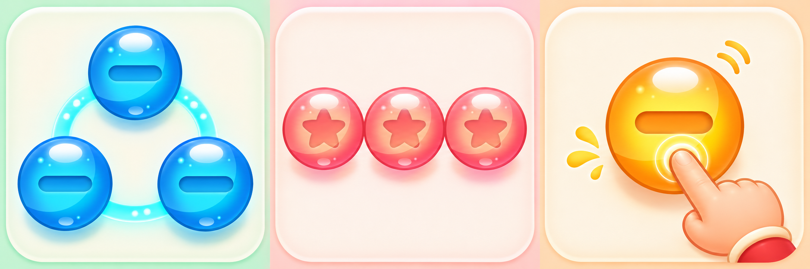
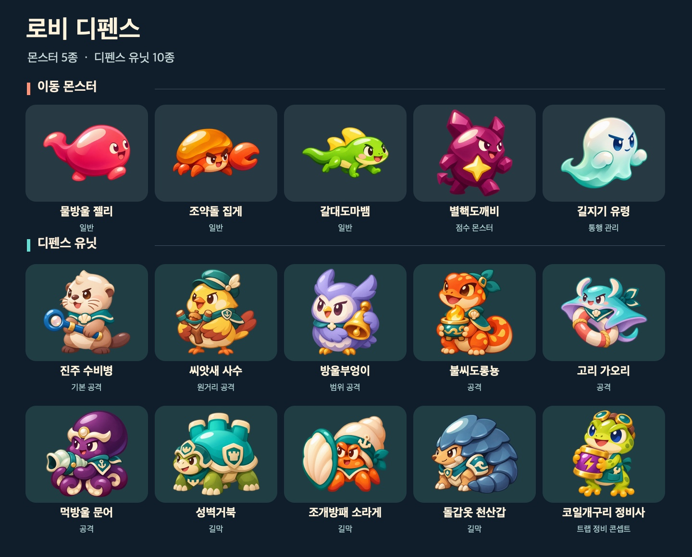
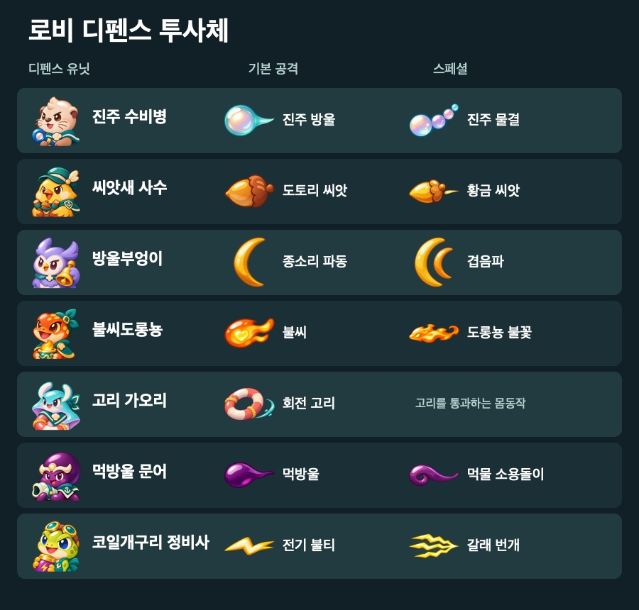

# 퍼즐 이미지 생성 가이드

퍼즐 조각 원본은 [Block](../../04_Resources/Ingame/Block), 보드 타일·게이지·팝업 등 다른 게임 이미지는 [Images](../../04_Resources/Images)에 둔다.

## 보드 블럭

| 생성할 때 첨부한 기준 그림 | 같은 스타일로 만든 원형 폭탄 |
|---|---|
|  |  |

새 블럭을 만들 때는 왼쪽 PNG를 참조 이미지로 첨부한다. 한 칸에 놓인 젤리처럼 보이게 하는 요소는 둥근 실루엣, 위쪽의 넓고 밝은 반사광, 아래쪽으로 짙어지는 색이다. 폭탄에서는 이 세 요소를 유지하고, 작은 화면에서도 일반 블럭과 구별되도록 짧은 심지로 외곽선을 바꾸고 중앙에 금색 불꽃 하나를 넣었다.

**폭탄 생성 프롬프트 예시**

> 첨부한 빨간 젤리 블럭과 한 세트로 쓸 원형 폭탄 아이콘을 그려줘. 정사각형 투명 캔버스 가운데 자두색 젤리 구체를 놓고, 왼쪽 위에는 연분홍색 타원형 반사광을 크게 넣어줘. 중앙에는 금색 네 갈래 불꽃 하나, 오른쪽 위에는 짧게 휜 심지와 작은 불빛을 넣어줘. 심지 끝까지 투명 여백 안에 들어오게 하고 바닥 그림자와 글자는 생략해줘. 32픽셀로 줄여도 심지와 중앙 문양이 읽히게 해줘.

최종 PNG는 기존 블럭과 같은 **256 × 256**, 투명 배경, 중앙 피벗으로 맞춘다. Unity에서는 단일 Sprite, Pixels Per Unit `1`로 임포트한다. 보드에 나란히 놓았을 때 일반 블럭과 몸체 크기가 어울리고 심지가 잘리지 않는지 확인한다. 파일명과 Addressables 주소는 블럭 ID를 따르며, 폭탄의 주소는 `Block_200-1`이다. [새 블럭 추가 방법](../03_Data/RULES-AND-STAGES.md#새-블럭-추가-방법)

## 준비 팝업 슬롯

릴은 **가로 3:1 이미지 한 장**이다. [파란 블럭](../../04_Resources/Ingame/Block/Block_100-2.png), [빨간 별 블럭](../../04_Resources/Ingame/Block/Block_100-1.png), [주황 블럭](../../04_Resources/Ingame/Block/Block_100-3.png)의 둥근 실루엣과 타원형 반사광을 사용한다. 민트·분홍·살구색 카드에 연결, 가로 정렬, 탭 동작을 각각 담는다.

**릴 생성 프롬프트 예시**

> 첨부한 보드 젤리의 색, 가운데 문양, 반사광을 유지해 같은 너비의 정사각형 카드 세 장을 가로로 붙여줘. 왼쪽은 파란 젤리 세 개를 빛나는 선으로 연결하고, 가운데는 빨간 별 젤리 세 개를 한 줄에 놓고, 오른쪽은 손끝이 주황 젤리를 누르는 순간을 그려줘. 밝은 파스텔 바탕에 각 그림이 온전히 들어가도록 하고 글자는 생략해줘.

기존 릴을 교체할 때는 정지 화면에서 한 칸씩 잘라 본다. 각 칸에 상징 하나가 온전히 보이고, 왼쪽부터 **링크 → 3매치 → 탭 매치** 순서가 컨트롤러의 `RulePaths`와 `ModeNames`에 맞아야 한다. 릴은 `PopupReady` 프리팹의 `RawImage`가 참조하는 텍스처다. 가로 반복(Wrap U = Repeat)을 유지해야 마지막 칸에서 첫 칸으로 이어진다. [준비 팝업 동작](../04_UI/UI.md#준비-팝업의-플레이-진입) · [PopupReady.cs](../../02_Scripts/UI/Popup/PopupReady.cs)

## 보드 타일과 피벗 게이지

- [사각 타일](../../04_Resources/Images/LagoonSquare.png)과 [육각 타일](../../04_Resources/Images/LagoonHex.png)은 청록색 에나멜에 오목하게 들어간 칸을 정면에서 본 모습이다. 생성 시 가운데를 비우고 왼쪽 위 가장자리만 밝게 잡아 젤리 블럭이 먼저 읽히게 했다.
- [게이지 프레임](../../04_Resources/Images/PivotGaugeFrame.png)은 금색 별이 달린 청록색 캡슐, [채움](../../04_Resources/Images/PivotGaugeFill.png)은 색을 입힐 수 있는 진주색 젤리 막대다. 두 원화 모두 글자와 눈금 없이 투명 배경으로 생성했다. 충전 중에는 청록빛, 활성 중에는 주황빛으로 채운다.

## 준비 팝업 패널

[레몬색 패널 원본](../../04_Resources/Images/ReadyPanelYellow.png)은 중앙이 연한 버터색이고 가장자리가 둥근 젤리 테두리다. 왼쪽 위 반사광을 테두리에 두고 중앙을 비워 제목·릴·라이프가 올라갈 자리를 확보한다. 모서리 바깥은 투명하게 내보낸다. 팝업 프리팹은 단일 Sprite를 흰색 틴트로 표시하고, 본문에는 진한 갈색, START에는 하늘색 버튼을 사용한다.

## 로비 디펜스 캐릭터

기본 원화의 몬스터는 왼쪽 입구에서 오른쪽 출구를 바라본다. 수비대는 입구를 바라보는 기본 포즈를 사용한다. 일반 몬스터 3종은 등껍질·몸통·꼬리 모양으로 구별한다. 점수 몬스터는 배에 금색 별이 있고, 길지기 유령은 발 없이 떠 있다. [로비 디펜스 기획](../01_Architecture/LOBBY-DEFENSE.md)

15종 모두 256 × 256 RGBA PNG이며 중앙 피벗과 PPU 1을 사용한다. 캐릭터의 긴 쪽을 약 218픽셀로 맞췄다. 유닛은 로비 한 칸을 차지하는 캐릭터 시안이다. 코일개구리가 들고 있는 장비는 마비 트랩에서 따왔다. 바닥에 배치되는 트랩은 별도의 오브젝트다.

Unity Addressables 주소는 `LobbyDefense/Monsters/파일명` 또는 `LobbyDefense/Defenders/파일명`이며 확장자는 생략한다.

캐릭터별 파일과 생성 프롬프트

각 이미지에 공통 프롬프트, 진영 프롬프트, 아래 개별 프롬프트를 차례로 사용했다.

**공통**

Create a single original full-body 2D character game sprite for a Korean mobile puzzle game's lagoon defense board, for one square grid cell. A 256px production sprite will be reduced to 32px. Big, economical silhouette and a clear face; 2 or 3 large overlapping forms. The visual reference is the game's round red jelly token with its recessed star, broad upper-left ivory reflection and dark saturated lower rim; the board tile is dark turquoise enamel, the special bomb glossy plum and gold. Paint clean 2D game art with smooth shaded jelly/enamel planes, one broad oval highlight on the main volume, dark colored contours only where forms meet. Small amount of warm pearl and a contrasting shaded rim for visibility against teal. Cheerful, purposeful expression, distinct species, no fine texture or realism. Orthographic three-quarter view from a little above, whole figure centered on a square, occupying about 78–83% on its longest axis. Keep appendages within one tile and preserve airy margins. True transparent background, clean alpha; absolutely no background, contact shadow, glow cloud, stand, badge frame, floating effects, lettering or numbers. Exactly one character, one idle pose.

**몬스터**

Moving monster. The head and gaze lead toward screen RIGHT (the route goes left to right). The readable profile leans slightly toward the exit; the tail or rear trails to the LEFT.

| 캐릭터 | 역할 | 개별 프롬프트 |
|---|---|---|
| [물방울 젤리](../../04_Resources/Images/LobbyDefense/Monsters/WaveJelly.png) | 일반 몬스터 | A bouncy raspberry-coral jelly polliwog. One large droplet-shaped body, two pearl dot eyes in the right-facing cheek, two small feet, and a single upturned wave tail trailing to the left. Mid-waddle. |
| [조약돌 집게](../../04_Resources/Images/LobbyDefense/Monsters/PebbleCrab.png) | 일반 몬스터 | A squat tangerine shore crab with a smooth amber pebble for its shell. One oversized rounded forward claw points right and one little rear claw sits low. Face with thick brows peeks out below the shell. Low wide silhouette. |
| [갈대도마뱀](../../04_Resources/Images/LobbyDefense/Monsters/ReedRunner.png) | 일반 몬스터 | A spring-green newt runner with a wedge-shaped rounded head, long low back, two buttery dorsal fins and one broad tapering tail trailing left. Show its short feet in a quick striding pose. Dark leaf-green lower rim. |
| [별핵도깨비](../../04_Resources/Images/LobbyDefense/Monsters/ScoreImp.png) | 퍼즐 점수로 소환되는 몬스터 | A little deep-plum crystal imp with two stubby angular ears, short striding legs and a prominent luminous gold four-point star embedded in its belly. Upright angular outline, mischievous right-facing three-quarter expression. Keep the gold star a solid simple shape. |
| [길지기 유령](../../04_Resources/Images/LobbyDefense/Monsters/PathWarden.png) | 5초마다 소환되는 통행 관리 유령 | A pearl-white and pale mint route-warden ghost, a rounded bell-shaped translucent spirit with two ink-blue eyes and a stern brow. Lower edge curls into one large floating swept-back tail, no feet, and two small raised mitten arms. The face is clearly readable on a dark teal tile. No skull, halo, crown or ghost props. |

**디펜스 유닛**

Placeable animal defender. Face and look toward screen LEFT, toward approaching monsters; body and feet settle into one tile. Friendly watch-team look: use a small lagoon-teal enamel or deep teal cloth accent and warm ivory detail, and one distinctive tool or piece of armor. Compact, broad, steady shapes; keep face unobstructed.

| 캐릭터 | 역할 | 개별 프롬프트 |
|---|---|---|
| [진주 수비병](../../04_Resources/Images/LobbyDefense/Defenders/PearlSentry.png) | 기본 공격 유닛 | A young cream sea otter sentry with a turquoise collar and short paddle tail. Tucks one thick blue bubble wand with a single round pearl at its muzzle under its near arm, pointing left. Wide whisker pads, alert face; the simplest starter silhouette. |
| [씨앗새 사수](../../04_Resources/Images/LobbyDefense/Defenders/SeedFinch.png) | 원거리 공격 유닛 시안 | A small buttery-yellow finch with a triangular orange beak, russet wing tips and a low teal cap. Both wings hold one squat Y-shaped twig slingshot with one broad teal band and an acorn seed seated in it. A stable perched stance on its own two feet. |
| [방울부엉이](../../04_Resources/Images/LobbyDefense/Defenders/BellOwl.png) | 범위 공격 유닛 시안 | A round periwinkle owl with two large ear tufts and an ivory facial disk. Hugs a single broad amber handbell to its left side, tilted so the open bell mouth and clapper read clearly. Two visible talons, tiny teal collar. |
| [불씨도롱뇽](../../04_Resources/Images/LobbyDefense/Defenders/EmberGecko.png) | 공격 유닛 시안 | A bright persimmon gecko keeper, wide smiling muzzle, thick tail curled beside its feet. Cradles a single squat teal brazier holding one large gold flame under its chin. Flame is attached and contained within the figure's outline. |
| [고리 가오리](../../04_Resources/Images/LobbyDefense/Defenders/RingRay.png) | 공격 유닛 시안 | A turquoise-and-lavender little manta ray guardian hovering low. Its diamond-shaped wing fins wrap around one thick ivory-and-coral return ring tilted diagonally; short tail curved close. Eyes on the upper surface, face emerges above the ring. |
| [먹방울 문어](../../04_Resources/Images/LobbyDefense/Defenders/InkOcto.png) | 공격 유닛 시안 | A midnight-violet octopus sentry, domed head with pearl brow and four strongly readable curled arm groups, firmly seated. Cradles a single pale mint conch with its dark open mouth pointing left like an ink launcher. Cozy teal band around conch. |
| [성벽거북](../../04_Resources/Images/LobbyDefense/Defenders/RampartTurtle.png) | 길막 유닛 | A stocky moss-green tortoise warden with four broad grounded feet and a warm ivory beaked face. Its oversized domed turquoise shell is shaped into three thick rounded battlements like a little fortress wall; no hand-held props. Readable low defensive silhouette. |
| [조개방패 소라게](../../04_Resources/Images/LobbyDefense/Defenders/ClamShield.png) | 길막 유닛 | An orange hermit crab defender carrying a huge ivory scallop shell as a raised front shield; only three bold scallop ridges. One chunky teal rim around the shell, exposed alert eyes and orange feet. The shield faces left and reads as a broad vertical oval. |
| [돌갑옷 천산갑](../../04_Resources/Images/LobbyDefense/Defenders/StonePangolin.png) | 길막 유닛 | A stout sandy pangolin curled protectively into a compact arch, its little pointed face and feet visible at the left. Three tiers of chunky slate-blue enamel scales overlap like armor plates, a small ivory chin guard, heavy ringed tail wraps close to body. |
| [코일개구리 정비사](../../04_Resources/Images/LobbyDefense/Defenders/CoilFrog.png) | 마비 트랩을 모티프로 한 유닛 시안 | A lemon-green tree frog mechanic with wide toes and large ink-blue eyes. Hugs a single short violet enamel coil drum with two thick golden bands and one recessed lightning-bolt mark. A tiny teal work apron. Fully visible standing character; the coil stays in its hands. |

## 프로필과 캐릭터 동작

[캐릭터를 선택해 프로필·동작 재생하기](LobbyDefenseMotion.html) · [프로필 PNG](../../04_Resources/Images/LobbyDefense/Profiles) · [캐릭터별 시트와 Unity 클립](../../04_Resources/Images/LobbyDefense/Motions)

프로필은 얼굴과 장비를 함께 담은 512 × 512 투명 Sprite다. 보유 목록과 유닛 상세에 같은 이미지를 사용할 수 있다. 동작 시트는 640 × 640이며, 왼쪽 위에서 오른쪽 아래 순으로 320 × 320 프레임 네 장을 담는다. 기본 스프라이트의 256 × 256 영역 사방에 32픽셀씩 여유를 둬, 공격 동작에서 캐릭터 크기를 유지하면서 장비와 이펙트를 담는다. 각 프레임은 중앙 피벗과 PPU 1을 사용한다.

| 대상 | 클립 | 재생 | 동작 |
|---|---|---|---|
| 수비 10종 | Idle | 4 FPS · 1초 반복 | 숨을 들이쉬고 내쉬며 눈이나 장비가 작게 움직인다. |
| 수비 10종 | Attack | 8 FPS · 0.5초 1회 | 준비, 예비 동작, 타격, 반동을 잇는다. |
| 수비 10종 | Special | 6 FPS · 약 0.67초 1회 | 대기 중 터치하거나 15초간 대기하면 보여 주는 캐릭터별 장기자랑. 실제 공격이 시작되면 공격 동작으로 전환한다. |
| 침공 몬스터 5종 | Walk | 8 FPS · 0.5초 반복 | 8방향 제자리 이동. 젤리는 뛰고 길지기 유령은 떠간다. |
| 침공 몬스터 5종 | Attack | 8 FPS · 0.5초 1회 | 길을 막은 인접 유닛을 향해 공격한다. [8방향 원화와 클립](INVADER-ART.md) |

인벤토리 초상은 `LobbyDefense/Profiles/{캐릭터 ID}`의 `Sprite`다. 확대 지도는 `LobbyDefense/Motions/{캐릭터 ID}/{동작}`의 `AnimationClip`에서 프레임을 읽어 표시한다. 방향별 몬스터 클립에는 경로 끝에 방향 이름을 붙인다. 시트는 클립과 함께 로드된다. 이동 좌표와 공격 시점은 전투 모델이 정한다. [실제 로비 표시 흐름](../01_Architecture/LOBBY-DEFENSE-ARCHITECTURE.md#책임과-수명)

프로필·애니메이션 생성 프롬프트

내장 ImageGen에 기존 캐릭터 PNG 한 장을 정체성 참조로 첨부한다. 공통 지시문 뒤에 동작 시트에만 배치 지시문을 붙이고 종류별 지시문을 이어 쓴다. 공격·스페셜·걷기에는 해당 캐릭터의 연출을 마지막에 덧붙인다. 아래 연출은 아트 시안이다.

**공통**

Input image 1 is the identity and rendering reference for exactly one existing character in a mobile lagoon puzzle game. Match its species, face, eye shapes, colors and markings, body proportions, contour treatment, equipment, clothing and broad upper-left glossy highlight. Hand-painted clean 2D enamel/jelly sprite art, bold graphic shapes that read at 48px. Transparent alpha background, without card, frame, scenery, cast shadow, text or numbering.

**시트 배치**

Deliver a single SQUARE 2 by 2 animation sprite sheet, exactly FOUR separate full-body drawings of the SAME character, one in each equally sized quadrant, read upper left, upper right, lower left, lower right. Arrange the four character roots at normalized (0.25,0.25), (0.75,0.25), (0.25,0.75), (0.75,0.75). Each full character and any attached effect fit inside the central 76 percent of its own square, with a wide EMPTY transparent cross between rows and columns. Fixed orthographic three-quarter camera, identical head scale in all four frames, level ground line per row. Draw different consecutive key poses with real limb motion, never a lineup of four identical figures or a single image divided into panels. No dividing lines.

| 종류 | 지시문 |
|---|---|
| Profile | Create a single square character selection PORTRAIT, not a full-body sprite or multiple poses. Expressive close-up of the face and shoulders in a friendly confident three-quarter turn, gaze a little toward screen left and the viewer. Fill the square with the face; silhouette of ears/horns stays within the upper margin; deliberate chest-level bust crop at bottom. Show a recognizable portion of the signature equipment or costume, keeping both eyes clear. Clean transparent outside silhouette. No text, badge frame, border, backdrop or sparkles. |
| Idle | Face LEFT throughout. Four phases of a subtle character-specific breathing loop: resting ready with eyes open; inhale and lift shoulders plus the equipment or shell just a little; exhale with a brief blink and soften knees; return toward ready with eyes reopening. Body rooted in the same spot with expressive anatomy, never turn the creature around. |
| Attack | Face LEFT throughout. Four successive phases of one readable basic attack, ready, anticipation, contact, then recoil back toward ready. Keep projectile or arc small and contained in the contact cell. Character-specific choreography: |
| Special | Face LEFT throughout. Four successive phases of its distinctive special action, a deep gathering pose, visible charge, decisive silhouette and compact peak effect, then dissipating recovery. Same anatomy, material and one existing tool as the reference. Keep any effect solid-edged, attached or nearby, and comfortably inside its cell. Character-specific choreography: |
| Walk | Face RIGHT in all four cells and animate walking IN PLACE for a seamless four-frame travel cycle. Camera, head scale and left/right orientation stay fixed. Character-specific stride: |

| 수비 유닛 | 공격 | 스페셜 |
|---|---|---|
| 진주 수비병 | Raise the blue wand with both paws, snap its pearl muzzle left, then pull the wand back to the chest. | Lift the pearl in a high arc with both paws, then cast a large single crescent of pearly bubbles to the left. |
| 씨앗새 사수 | Nock a brown seed, open the wings to pull the teal slingshot band taut, release the single seed to the left and relax. | Sink low and draw deeply, then fan three chunky golden seeds from the raised slingshot to the left. |
| 방울부엉이 | Tip the handbell back, thrust it left with a clear swinging brass clapper, then settle the wing. | Lift the bell with both wings overhead, swing low to the left and send two tight golden crescent-shaped sound waves. |
| 불씨도롱뇽 | Pull the brazier under the chin, tilt its open rim left with both hands to flick a single ember, then catch it upright. | Cradle the brazier low, lift it high, then tip it to the left as its flame curls into one broad gold salamander-shaped plume. |
| 고리 가오리 | Fold wing fins around its coral and ivory ring, bank to throw the ring left, then hook its returning edge with a fin. | Bank steeply, pass the ring over its head, then spiral through it with a single broad turquoise wake curling to the left. |
| 먹방울 문어 | Pull the conch back with its arm tips, plant bottom arms wide and point the conch left to spit one drop of violet ink, then relax. | Lift the mint conch with curled arms, brace and blast a big spiralling dark violet ink curl to the left. |
| 성벽거북 | Bend its front legs, tuck the chin and bump the crenellated shell toward screen left, then straighten. | Retract its head and brace all four legs, slam the shell down and flash a compact gold-edged teal parapet around its back. |
| 조개방패 소라게 | Tuck behind the ivory scallop shield, tip forward in a short shield bash to the left, then draw it back. | Plant its crab legs, lift the scallop shield, then slam its base down to form a tight fan of ivory shell ridges on the left. |
| 돌갑옷 천산갑 | Wind up its heavy plated tail, swing the tail around the near side in a leftward sweep, then tuck it close. | Curl into a closed armored ball, roll in place in a leftward strike, show one short slate-and-gold impact arc and uncurl. |
| 코일개구리 정비사 | Lean back gripping the violet coil drum, extend it left to pulse one compact golden spark, then pull it close. | Crouch to prime the coil, lift it above its goggles, then channel a forked golden charge from the drum toward the left. |

| 몬스터 | 걷기 |
|---|---|
| 물방울 젤리 | Show a lively rightward hop walk: forward foot planted and tail up; body squashes with feet passing; opposite foot extends as body rises and tail unfurls; rear foot pushes off. Preserve the two tiny feet. |
| 조약돌 집게 | Show a lively rightward scuttle: near walking legs lead; body sinks and legs pass; opposite walking legs lead; body rises as rear legs push off. Large claw remains at RIGHT. |
| 갈대도마뱀 | Show a quadruped trot to the right: left diagonal feet reach; legs collect underneath; opposite diagonal feet reach; hind legs extend in push-off. Long tail counterbalances. |
| 별핵도깨비 | Show a biped march to the right: near foot forward and far arm swings; low passing crouch; opposite foot forward and near arm swings; tall passing pose. Keep gold belly star visible. |
| 길지기 유령 | Show a legless gliding walk equivalent to the right: lean forward with the mint tail extended left; lift the mittens and curl tail under; lead with the opposite mitten as the crest rises; sweep the tail back for the looping drift. Never add legs. |

성벽거북 대기 시트의 투명 여백 보정 지시문

The exported sheet is four isolated alpha cutouts. Every pixel outside the turtle contours is fully transparent: alpha zero. The empty cross through the exact canvas center is completely empty. No fog, mist, ground shading, floor, shadow or white backdrop in any cell. Match the transparent reference's alpha. Show ready, inhale, blink, reopen.

## 공격 투사체

[씨앗새의 황금 씨앗 발사 보기](LobbyDefenseMotion.html#SeedFinch/Special) · [투사체 PNG 폴더](../../04_Resources/Images/LobbyDefense/Projectiles)

기본 공격 7종과 스페셜 6종을 각각 128 × 128 투명 단일 Sprite로 저장했다. 중앙 피벗, PPU 1이며 긴 쪽의 그림은 약 112픽셀이다. 기본 진행 방향은 왼쪽이다. Addressables 키는 `LobbyDefense/Projectiles/{유닛 ID}/{Attack 또는 Special}`이다.

미리보기에서는 3번째 프레임에 장비 끝에서 발사한다. 기본 공격은 시작 후 0.25초, 스페셜은 약 0.33초다. 씨앗새의 스페셜은 황금 씨앗 한 장을 세 갈래로 펼치고, 가오리의 기본 공격은 같은 고리가 되돌아온다. 거북·소라게·천산갑의 근접 공격과 가오리의 스페셜은 캐릭터 동작으로 표현한다.

| 수비 유닛 | 기본 공격 | 스페셜 |
|---|---|---|
| 진주 수비병 | [진주 방울](../../04_Resources/Images/LobbyDefense/Projectiles/PearlSentry/Attack.png) | [진주 물결](../../04_Resources/Images/LobbyDefense/Projectiles/PearlSentry/Special.png) |
| 씨앗새 사수 | [도토리 씨앗](../../04_Resources/Images/LobbyDefense/Projectiles/SeedFinch/Attack.png) | [황금 씨앗](../../04_Resources/Images/LobbyDefense/Projectiles/SeedFinch/Special.png) |
| 방울부엉이 | [종소리 파동](../../04_Resources/Images/LobbyDefense/Projectiles/BellOwl/Attack.png) | [겹음파](../../04_Resources/Images/LobbyDefense/Projectiles/BellOwl/Special.png) |
| 불씨도롱뇽 | [불씨](../../04_Resources/Images/LobbyDefense/Projectiles/EmberGecko/Attack.png) | [도롱뇽 불꽃](../../04_Resources/Images/LobbyDefense/Projectiles/EmberGecko/Special.png) |
| 고리 가오리 | [회전 고리](../../04_Resources/Images/LobbyDefense/Projectiles/RingRay/Attack.png) | 고리를 통과하는 몸동작 |
| 먹방울 문어 | [먹방울](../../04_Resources/Images/LobbyDefense/Projectiles/InkOcto/Attack.png) | [먹물 소용돌이](../../04_Resources/Images/LobbyDefense/Projectiles/InkOcto/Special.png) |
| 코일개구리 정비사 | [전기 불티](../../04_Resources/Images/LobbyDefense/Projectiles/CoilFrog/Attack.png) | [갈래 번개](../../04_Resources/Images/LobbyDefense/Projectiles/CoilFrog/Special.png) |

투사체 생성 프롬프트

내장 ImageGen에 공격하는 유닛의 기본 스프라이트를 참조로 첨부하고, 아래 공통 지시문 뒤에 개별 지시문을 붙였다.

Use case: stylized-concept. Create one detached in-flight magical projectile sprite for a small mobile lagoon puzzle-defense game. The attached character image is a material, equipment and palette reference ONLY. Draw solely the expelled object or wave, no character, hand, tool, or launcher. Match the reference's cheerful hand-painted 2D enamel/jelly shading, restrained dark colored rim, broad upper-left ivory highlight, simple clear silhouette legible at 24 px. Side view travelling from RIGHT to LEFT. Fit the fully visible shape near the center of a square with generous transparent alpha margins. Transparent outside the silhouette and in holes, no floor, shadow, background haze, frame, letters, white matte or number. One image, one flight sprite, no animation sheet.

| 투사체 | 개별 지시문 |
|---|---|
| 진주 방울 | A near-round iridescent pearl bubble in flight, ivory pearl core, transparent-looking aquamarine rim, tiny cool-blue crescent reflection and one short tapered aqua wake on the RIGHT. Keep the round leading edge at LEFT. |
| 진주 물결 | A single crescent wave composed of a LARGE pearl bubble leading on the left and three progressively smaller pastel lavender, pink and aqua pearly bubbles trailing UP and to the RIGHT along one graceful crescent. Clear bead silhouettes and deep aqua rims. |
| 도토리 씨앗 | A single plump little acorn seed from the sling. Smooth honey-brown nut taper pointing LEFT, dark russet cap on the RIGHT with a nub and two simple cap markings. Glossy amber highlight. No shell fragments or streaks. |
| 황금 씨앗 | Just ONE luminous golden acorn seed for a three-shot fan. Rounded golden cap on RIGHT, yellow tapered tip on LEFT. Warm ochre underside, broad pale-cream highlight, one modest golden speed accent trailing RIGHT. The game will instantiate this sprite three times: draw exactly one seed. |
| 종소리 파동 | One compact curved brass-gold sound pulse from a handbell. A single thick, shallow opening-parenthesis-shaped crescent, outer convex dome toward LEFT and tapered upper and lower tips toward RIGHT. Honey-gold body with warm amber lower rim and one stripe of cream highlights. |
| 겹음파 | Exactly two nested, spaced, curved golden sound-wave crescents travelling LEFT. Both like opening parentheses, convex on LEFT, tips toward RIGHT. Broader, taller leading brass crescent and slightly smaller honey-orange echo behind it. Two graphic bands, negative space between, no circular disc. |
| 불씨 | One airborne ember with a rounded tangerine teardrop head on the LEFT and two short swept flame tongues on the RIGHT. Compact bright gold molten heart. Chunky enamel flame silhouette. |
| 도롱뇽 불꽃 | A single broad magical golden flame plume shaped like a fleeting salamander silhouette. Its leading blunt fire-snout at LEFT, shallow crest, warm orange underside, curled fiery tip trails RIGHT. Eyes only suggested by a single yellow gap, no solid animal, no limbs separate from flame. |
| 회전 고리 | Only the manta’s returning throw ring in flight. One thick buoy-like coral-red and warm ivory striped ring, tilted into a clear three-quarter oval. Large genuinely transparent center hole, a thin wine-colored lower rim, one small arc of turquoise wake following it to the RIGHT. No wings or fins. |
| 먹방울 | A single glossy, midnight-violet ink droplet traveling LEFT. Fat round purple bulb to the left, one narrow swept tail on the right, lavender highlight and a small magenta lower reflection. Fully saturated dark purple, high contrast. |
| 먹물 소용돌이 | One compact spiraling ribbon of violet ink moving LEFT. Tight rounded curl leads at LEFT with transparent negative space in its center, tapering brushlike liquid tail sweeps to the RIGHT. Dark plum, grape purple and one lavender specular edge. |
| 전기 불티 | An isolated, horizontally flying, short magical lightning spark composed ONLY of a single thick cream-white zigzag with a rich gold and amber outline. The pointed leading end is on the left, the trailing two taper points on the right. Absolutely no purple object, no cylindrical part, no end cap, no handle, no coil or drum or any hardware. The launching device stays with its owner outside this image. Favor a short wide two-bend electric spark, readable when tiny. |
| 갈래 번개 | A horizontal forked electrical discharge made ENTIRELY OF LIGHT, like a fork of painted golden lightning viewed from the side. One crackling taper on the far RIGHT splits into three separate long chunky angular golden paths with pointed tips reaching LEFT. Canary yellow borders and white-hot cores, separated by transparent space. No end cap, drum, cylinder, tool, handle, sockets or physical objects. No violet hardware. Exactly one three-fork discharge floating freely. |

